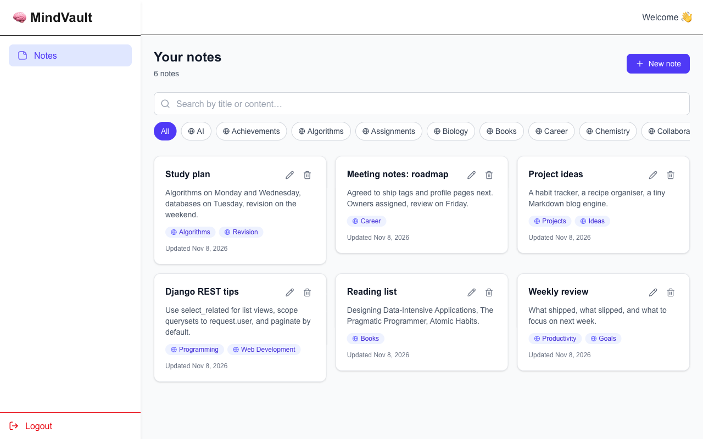

# MindVault

A personal notes app. Sign up, jot things down, tag them, and find them again
quickly. Notes and tags are private to your account.



<!-- Add a screenshot at docs/screenshot.png and it will appear above. -->

## Features

- JWT authentication with access/refresh tokens (sign up, log in, stay signed in)
- Create, edit and delete notes, with a confirmation step before deleting
- Tag notes with your own tags or built-in global tags; create new tags inline
- Search notes by title or content, filter by tag, paginated results
- Per-user isolation: you can only ever read or modify your own notes and tags
- Responsive, keyboard-accessible UI that works from small phones to desktops

## Tech stack

**Backend** (`backend/`)

- Python + Django 5.2
- Django REST Framework
- JWT auth via `djangorestframework-simplejwt`
- `django-cors-headers`, `python-dotenv`
- SQLite for local development

**Frontend** (`frontend/`)

- Next.js 16 (App Router) + React 19
- TypeScript
- Tailwind CSS 4
- axios, js-cookie, lucide-react

## Getting started

### Prerequisites

- Python 3.10+
- Node.js 20.9+

### Backend

```bash
cd backend
python -m venv .venv
source .venv/bin/activate        # Windows: .venv\Scripts\activate
pip install -r requirements.txt
cp .env.example .env
python manage.py migrate
python manage.py runserver       # serves http://127.0.0.1:8000
```

The default `.env.example` sets `DJANGO_DEBUG=true`, which is enough for local
development. To run with debug off, set a real `DJANGO_SECRET_KEY` and
`DJANGO_ALLOWED_HOSTS` in `.env`. Never commit your `.env` file.

### Frontend

```bash
cd frontend
npm install
cp .env.example .env.local
npm run dev                      # serves http://localhost:3000
```

`NEXT_PUBLIC_API_URL` in `.env.local` points the app at the Django API
(`http://127.0.0.1:8000/api` by default).

## Running the tests and checks

```bash
# Backend test suite (creates a throwaway test database)
cd backend
DJANGO_DEBUG=true python manage.py test

# Frontend lint + production build
cd frontend
npm run lint
npm run build
```

## API overview

All endpoints are under `/api/` and require a `Bearer` access token unless noted.

| Endpoint | Description |
| --- | --- |
| `POST /api/auth/register/` | Create an account (open) |
| `POST /api/auth/login/` | Obtain access + refresh tokens (open) |
| `POST /api/auth/refresh/` | Refresh the access token (open) |
| `GET/POST /api/notes/` | List (paginated, `?search=`, `?tag=`, `?page=`) / create notes |
| `GET/PATCH/PUT/DELETE /api/notes/<id>/` | Retrieve, update or delete a note |
| `GET/POST /api/tags/` | List (your tags + global tags) / create a tag |
| `GET/PATCH/PUT/DELETE /api/tags/<id>/` | Manage a personal tag; global tags are read-only |

## Project structure

```
backend/        Django project (mindvault) + core app (notes, tags, auth)
frontend/       Next.js app — pages under src/app, UI under src/components
```

## Contributing

See [CONTRIBUTING.md](CONTRIBUTING.md).

## Security

See [SECURITY.md](SECURITY.md) for how to report vulnerabilities.
